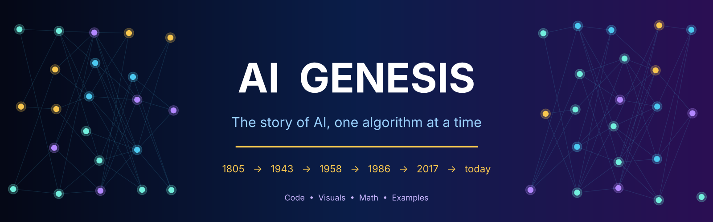
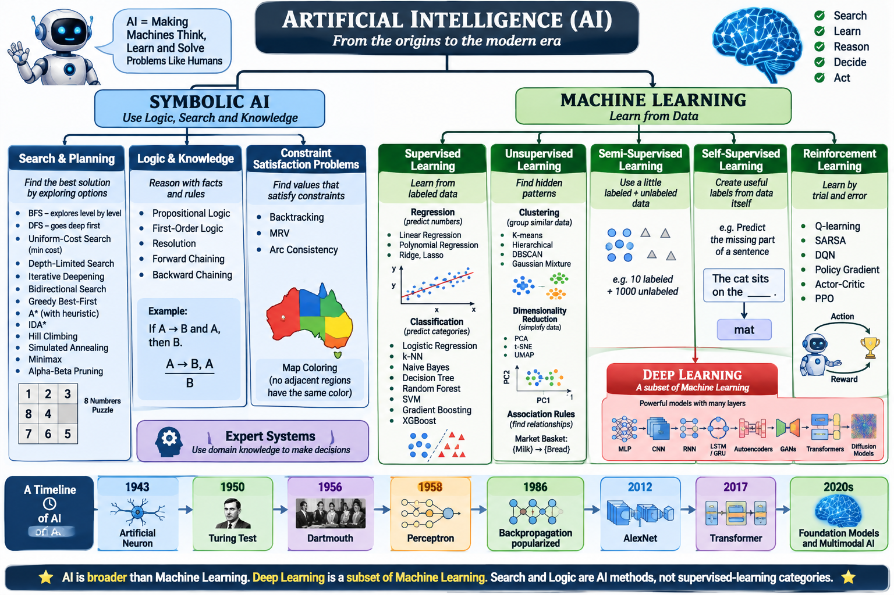
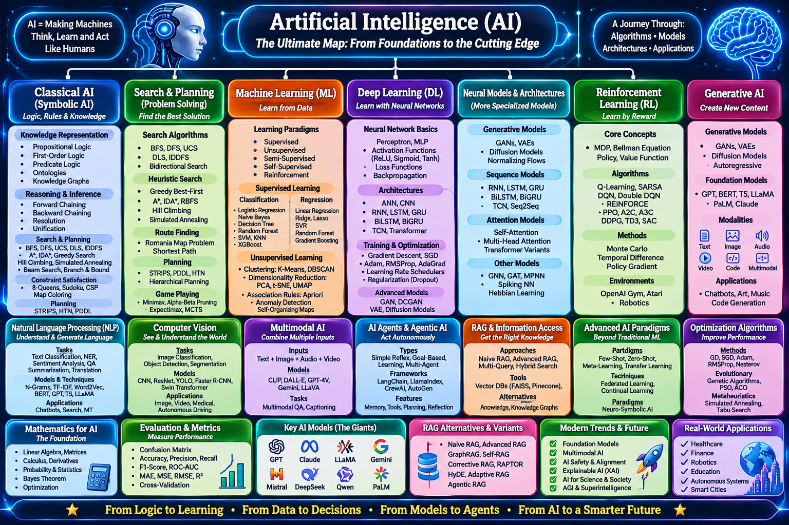
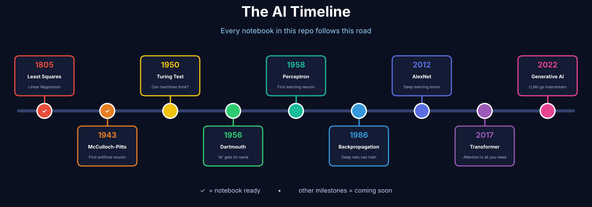

<p align="center">
  
</p>

<h3 align="center">🧬 The story of AI, one algorithm at a time</h3>

<p align="center">
  
  
  
  
  
</p>

<p align="center">
  <b>From the first mathematical neuron (1943) to Transformers and beyond.</b><br>
  Every algorithm gets its own notebook, built <b>in chronological order</b>, with history, intuition, math, code from scratch, visuals and exercises.
</p>

---

## ✨ Why this repo?

Most courses teach AI as a pile of disconnected topics. **AI Genesis** teaches it as a **story**: each idea appears because the previous one hit a wall.

> The McCulloch-Pitts neuron could not learn → the **Perceptron** learned. 
> The Perceptron could not solve XOR → **multi-layer networks and Backpropagation** solved it.
> And so on, all the way to today.

| | |
|---|---|
| 🕰️ **Chronological** | Learn algorithms in the order they were invented, so you see *why* each one exists |
| 🧪 **Hands-on** | Every notebook runs top to bottom, no downloads needed (datasets are built into libraries) |
| 🎨 **Visual** | Colourful charts and diagrams drawn with code |
| 🔢 **Real numbers** | Small worked examples you can follow by hand, then verify with code |
| 🌱 **Beginner friendly** | A short explanation before every code cell |
| 📝 **Practice** | Exercises at the end of each notebook, with hidden solutions |

---

## 🗺️ The big picture

AI is broader than Machine Learning. Machine Learning contains Deep Learning. Search and Logic are AI methods too, not supervised-learning categories.

<p align="center">
  
</p>

And this is the full map this repo is working through:

<p align="center">
  
</p>

---

## 🕰️ The timeline

<p align="center">
  
</p>

---

## 📚 Roadmap

### 🔍 Search & Planning (Symbolic AI)

| Notebook | Examples |
|---|---|
| Uninformed Search | BFS, DFS, Uniform-Cost Search, Depth-Limited, Iterative Deepening, Bidirectional |
| Informed (Heuristic) Search | Greedy Best-First, A\*, IDA\*, Hill Climbing, Simulated Annealing |
| Game Playing | Minimax, Alpha-Beta Pruning, Expectimax |
| Classic Puzzles | 8-Puzzle, 8-Queens, Map Coloring, Water Jug, Missionaries & Cannibals |
| Logic & Reasoning | Propositional Logic, First-Order Logic, Forward / Backward Chaining |

### 🤖 Machine Learning

| Type | Algorithms |
|---|---|
| **Supervised** | Linear / Polynomial / Ridge / Lasso, Logistic Regression, Decision Tree, Random Forest, SVM, Gradient Boosting, XGBoost |
| **Unsupervised** | K-Means, Hierarchical, DBSCAN, Gaussian Mixture, PCA, t-SNE, UMAP, Apriori / FP-Growth |
| **Semi-Supervised** | Self-Training, Co-Training, Pseudo-Labeling |
| **Self-Supervised** | Masked prediction ("The cat sits on the ___") |
| **Reinforcement** | Q-Learning, SARSA, DQN, Policy Gradient, Actor-Critic, PPO |

### 🧠 Deep Learning

| Topic | Models |
|---|---|
| Basics | Backpropagation, Activation Functions, Loss Functions, Optimizers (SGD, Adam) |
| Architectures | MLP, CNN, RNN, LSTM / GRU, Autoencoders |
| Generative | GANs, VAEs, Diffusion Models |
| Attention era | Self-Attention, Transformers, BERT, GPT |

### 🚀 Modern AI

Large Language Models · RAG · Multimodal Models · AI Agents · Fine-tuning · Evaluation & Metrics

---

## 🧩 What is inside every notebook?

Every notebook follows the same friendly template:

1. 🎨 **Banner and quick card**: name, year, inventors, family, difficulty
2. 📖 **The story**: who invented it and why
3. 🧠 **The idea in plain words**
4. ➗ **The math**, kept short and visual
5. 🤖 **Code from scratch**, then with a library when relevant
6. 📊 **Charts** that show what the algorithm is doing
7. 🔢 **Worked examples with numbers**
8. ⚠️ **Limitations** and what came next
9. 📝 **Summary**
10. 🧪 **Exercises** with hidden solutions

---

## ⚡ Quick start

```bash
# 1. Clone the repo
git clone https://github.com/YOUR_USERNAME/AI-Genesis.git
cd AI-Genesis

# 2. Install what you need
pip install numpy pandas matplotlib scikit-learn jupyter

# 3. Launch Jupyter and open any notebook
jupyter notebook
```

**No installation?** Open notebook in Google Colab

---

## 🎓 How to study

1. Go in order. Each notebook builds on the previous story.
2. **Run** every cell, then **change** a number and re-run to see what happens.
3. Try the exercises *before* opening the solutions.
4. After each notebook, write the idea in one sentence in your own words.

---

## 🤝 Contributing

Found a typo, a bug, or a better explanation? Pull requests and issues are welcome.

1. Fork the repo
2. Create a branch: `git checkout -b improve-perceptron-notebook`
3. Commit and push your changes
4. Open a Pull Request

---

## 👩‍💻 Author

Created by **Mariam Salem**.

---

<p align="center">
  ⭐ If this repo helps you, give it a star. It motivates me to keep building! ⭐<br><br>
  <i>From Logic to Learning • From Data to Decisions • From Models to Agents</i>
</p>
